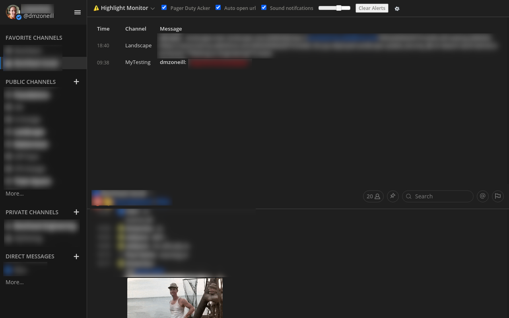
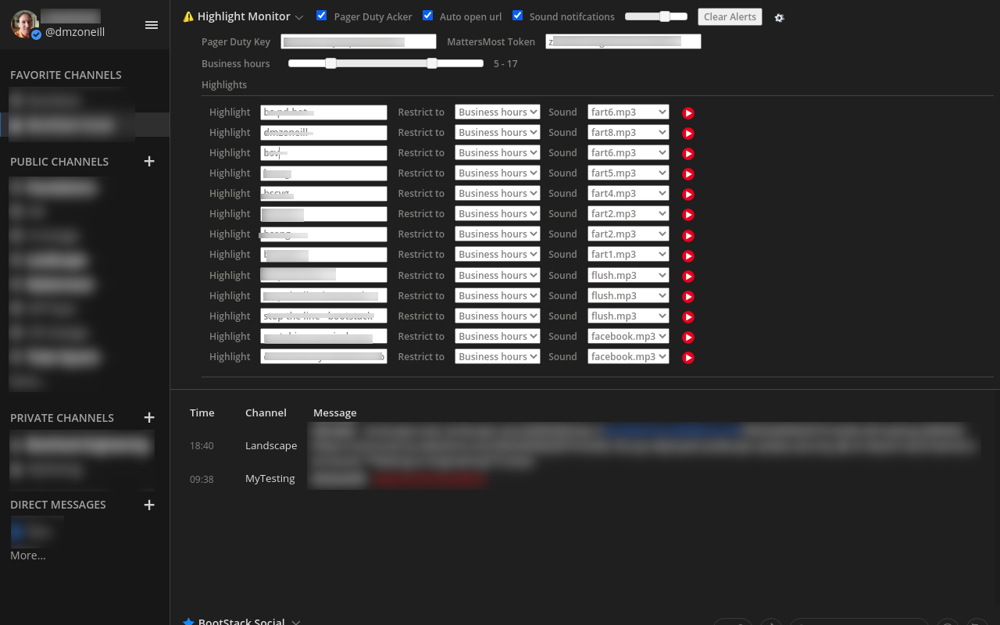

# MattersHighLight

<p align="center">
  
</p>

Get started:

```text
git clone https://github.com/dmzoneill/MattersHighLight.git
cd MattersHighLight
mkdir userdir
```

<br>

Modify manifest.json (to provide your own sounds) if you wish:

```text
vim manifest.json
```

<br>

Prep the icon, separate binary and copy the desktop file into place

```text
sudo cp /opt/google/chrome/google-chrome /opt/google/chrome/mattersmost
sudo inkscape -z -w 128 -h 128 /opt/Mattermost/icon.svg -e /opt/Mattermost/mm.png
```

<br>

Creating a separate window with matters most icon

```text
cat HighMonMattersMost.desktop
[Desktop Entry]
Encoding=UTF-8
Version=1.0
Type=Application
Terminal=false
Exec=/opt/google/chrome/mattersmost --autoplay-policy=no-user-gesture-required --disable-features=PreloadMediaEngagementData,AutoplayIgnoreWebAudio,MediaEngagementBypassAutoplayPolicies --new-window --app=https://chat.yourhost.com --user-data-dir="/home/dmzoneill/src/bsMMhighmon/userdir" --class="Chr2"
Name=Highmon MattersMost
Icon=/opt/Mattermost/mm.png
StartupWMClass=Chr2
StartupNotify=true
Categories=Network;WebBrowser;
```

<br>

Copy desktop file in place

```text
cp HighMonMattersMost.desktop  ~/.local/share/applications/
```

<br>

To install the extension, the first time you need to run it without "--app=<https://chat.yourhost.com>"
go to:

```text
extensions > load plugin > select to plugin folder
```

<br>

Visit your matters most site:

```text
click settings, provide MM auth token and pagerduty key
```

<br>


<br>

# Bootstack-Highlight-Monitor
